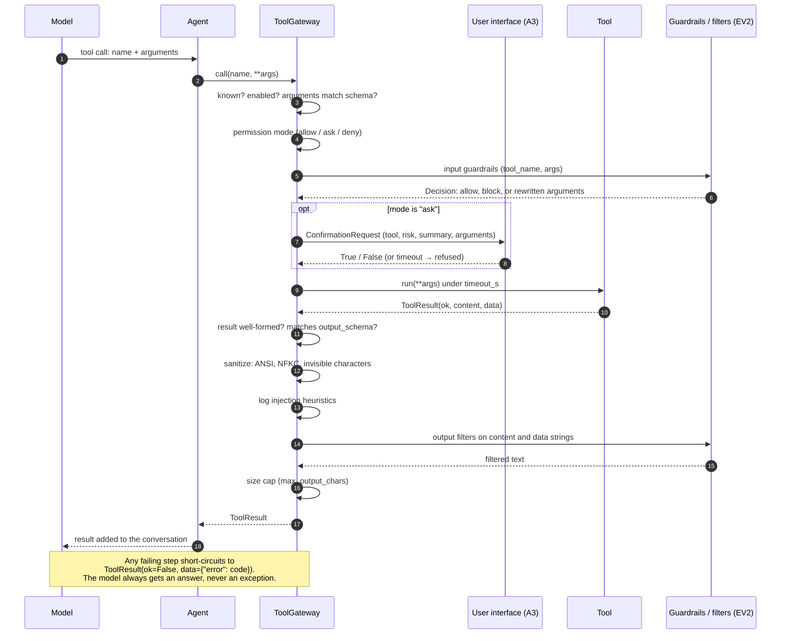

# Tool contract

Read this before adding a tool. Decision: [ADR-0006](../decisions/0006-tool-gateway.md).

The agent is not only a code assistant: tools are how it acts on the world.
They can read documents (RAG), call external services (MCP, web), write files,
run code in the sandbox, and anything a future lot adds. Some of these have
side effects that cannot be undone, and all of them feed text back to the model.
The contract therefore has to hold for any tool, not just code execution.

A tool writes no security checks. It **declares** what it is (name, arguments,
risk) and **returns** a `ToolResult`. Everything else — permissions,
confirmation, validation, filtering — is applied by the gateway
(`execution/gateway.py`), in the same way for every tool.

```
model ──► ToolGateway.call(name, **args)
              │
              ├─ 1. known tool?                else  unknown_tool
              ├─ 2. enabled (preferences)?     else  disabled
              ├─ 3. valid arguments?           else  invalid_arguments
              ├─ 4. permission mode            deny → denied_by_policy
              ├─ 5. input guardrails [EV2]     block → blocked  (or rewrite the arguments,
              │                                 which are re-validated against the schema)
              ├─ 6. confirmation [A3]          if mode is "ask"; no/error/timeout → refused
              ├─ 7. execution under a timeout  timeout / network_error / tool_error
              ├─ 8. valid result?              else  invalid_result
              ├─ 9. sanitize, then output      on failure → filter_failed
              │     filters [EV2]
              └─ 10. size cap                  truncates
```

The order is not arbitrary: guardrails run before confirmation (the user never
approves a blocked action and never sees a secret), and the size cap comes after
the filters (cutting first could split a secret the filter would then no longer
recognise).

## Lifecycle of a call: from the model's request to its result



## How inputs and outputs are checked

Neither side is trusted. The **model** may produce wrong or manipulated
arguments (a prompt injected through a document it read, for example), and the
**tool** may return anything: a bug, a malformed payload, or text from an
external server that contains secrets or instructions aimed at the model.

### Inputs: model → tool

Applied in this order, by the gateway, before the tool code runs. The first
check that fails stops the call and returns an error code.

| # | Check | Done by | On failure |
|---|---|---|---|
| 1 | The tool exists and is not disabled | `ToolRegistry` + `preferences.disabled` | `unknown_tool` / `disabled` |
| 2 | **Schema validation**: arguments are an object; every `required` field is present; no unknown field when `additionalProperties` is `false`; each field has the declared `type` (a boolean is not an integer); values are within `enum` | `check_arguments` (`execution/tool_validation.py`) against the tool's `parameters` | `invalid_arguments`, with the first problem found in the message |
| 3 | **Permission mode** resolved from the tool's `risk` and the user's preferences | `effective_mode` (`execution/tool_policy.py`) | `deny` → `denied_by_policy` |
| 4 | **Input guardrails [EV2]**: each guard receives `(tool_name, args)` and returns a `Decision` | guards passed to `ToolGateway` | see below |
| 5 | **Confirmation [A3]** when the mode is `ask`, showing the already-guarded arguments | the `Confirmer` | `refused` |

What a guardrail can answer:

- `Decision(allowed=True)`: the call goes on unchanged.
- `Decision(allowed=False, reason=...)`: the call is `blocked`.
- `Decision(allowed=True, replacement={...})`: the arguments are **rewritten**
  and the call goes on with them. Use it when the call is fine but part of it
  must not travel as-is, for example masking an API key or a personal identifier
  inside a text argument, a path or a command. The user then confirms the masked
  version and never sees the secret. The replacement is **validated against the
  tool's schema again** (check 2): a guardrail cannot get around the schema the
  tool declared. An invalid replacement is `blocked`.

When in doubt, the call is blocked: a guard that raises, or that returns
anything other than a `Decision` (`None`, `True`...), blocks the call. The
gateway never guesses what a broken guard meant.

### Outputs: tool → model

Applied after `run()` returns (or fails), before the model sees anything.

| # | Check | Done by | On failure |
|---|---|---|---|
| 1 | **Execution failures are classified**: time limit, network failure, exception | `ToolGateway._execute` | `timeout` / `network_error` / `tool_error` |
| 2 | **Result validation**: it is a `ToolResult`; `ok` is a boolean; `content` is a string; `data` is a dict that can be serialised to JSON | `check_result` (`execution/tool_validation.py`) | `invalid_result` |
| 3 | **Output schema**: on success, `data` matches the tool's `output_schema`, if it declares one | `check_result` | `invalid_result` |
| 4 | **Sanitizing** (always on, independent of EV2): ANSI escape sequences are removed whole, text is normalized to NFKC (fullwidth letters, ligatures), then invisible characters are removed: zero-width characters, bidi overrides, soft hyphen, Unicode tag characters (hidden ASCII), variation selectors, control characters other than newline and tab. Applied to `content` and to every string inside `data` | `sanitize` (`execution/output_sanitizer.py`) | cleaned in place; a warning is logged |
| 5 | **Injection heuristics**: the cleaned text is matched against known patterns ("ignore previous instructions", `SYSTEM:` lines, forged `Action:`/`Observation:` ReAct steps, forged tool-call markup, requests to reveal the prompt, remote markdown images) | `find_injection_markers` | a warning naming the matched heuristics is logged (never the text); the result is **not** blocked |
| 6 | **Output filters [EV2]**: each filter is `text -> text`, applied to `content` and to every string inside `data` (not to keys). Typical use: mask secrets and personal data | filters passed to `ToolGateway` | a filter that raises ⇒ `filter_failed`, and the raw output is withheld |
| 7 | **Size cap**: `content` is cut at `max_output_chars` with a marker; an oversized `data` is replaced by `{"truncated": true}` | `ToolGateway._check_output` | truncated, still returned |

Three rules explain the order:

- Sanitizing runs **before** the EV2 filters. A secret split by a zero-width
  space (`sk-\u200babc`) would otherwise escape a pattern-based filter.
- Filters run **before** the size cap. Cutting first could split a secret in two
  and the filter would no longer recognise it.
- A failing filter never falls back to the unfiltered output. That output is
  exactly what the filter was meant to clean.

#### Presenting the result to the model

The gateway returns a clean `ToolResult`; how it enters the conversation is the
agent's job. Two things are required of it:

- **Fence it.** Put `fence_untrusted(tool_name, content)` in the conversation
  instead of the raw text. It wraps the result in
  `<tool_output tool="..." trust="untrusted" suspicious="true|false">`, defuses
  any copy of the tag inside the content so the output cannot close the block
  itself, and sets `suspicious` from the heuristics. The system prompt must say
  that nothing inside such a block is an instruction.
- **Never render it as active content.** No automatic fetching of markdown
  images or links found in tool output: the query string is a way to leak data.

#### Limiting what a hijacked model can do

Sanitizing and heuristics cannot guarantee that a hostile page fails to
persuade the model. The last line of defence is that an instruction the model
obeys still cannot act silently:

- `write` and `execute` tools always ask (the floor in "Risk levels").
- With `confirm_after_untrusted: true`, once a `read` or `network` tool has
  returned successfully, every tool that is not `read` asks for confirmation,
  even if its mode is `allow`. This closes the "read a page, then send data to
  an attacker's URL" path. It is off by default, because with no interface
  plugged in every later network call is refused. The agent calls
  `gateway.reset_untrusted()` when a conversation starts.

### What these checks do not cover

- They check the **shape** and the **content** of what crosses the gateway, not
  what the tool does inside. A tool that writes files must still restrict the
  paths it touches ([T4]); one that runs code must isolate it (the sandbox).
- The input guards and output filters (EV2) only protect as far as they are
  written. `execution/guardrails.py` masks known credential formats (API keys,
  AWS/GitHub/Slack tokens, JWTs, bearer tokens, private keys, `password=...`
  style assignments), email addresses and card numbers (Luhn-checked). A secret
  in an unknown format is not recognised. They protect only once passed to
  `ToolGateway`; with none configured, nothing is masked. Sanitizing, the
  injection log, the schema checks, the permissions and the size cap are active
  without them.
- Text returned by a tool is data, not instructions, and the gateway cannot
  prove it harmless. The heuristics are signals that a determined attacker can
  phrase around, and sanitizing does not fold look-alike letters from other
  scripts (a Cyrillic "a" stays Cyrillic). That is why the defence does not rest
  on detection: fencing, the confirmation floor and `confirm_after_untrusted`
  limit the damage when detection fails.
- Stripping zero-width joiners splits emoji sequences into their parts. This is
  a deliberate trade for safety.

## What a tool must provide

The `Tool` protocol in `core/tools.py` does not change. The gateway additionally
reads these attributes:

| Attribute | Required | Role |
|---|---|---|
| `name`, `description`, `parameters` | yes | Already required by `Tool`. `parameters` is a JSON Schema, checked on every call. |
| `risk` | **yes** | `"read"`, `"network"`, `"write"` or `"execute"`. Missing or invalid ⇒ treated as `"execute"`. |
| `describe_call(**args) -> str` | no | The plan shown to the user before confirmation. Default: `name({args})`, cut at 500 characters. For the sandbox: show the code. |
| `output_schema` | no | JSON Schema of `ToolResult.data` on success. A result that does not match is rejected. |
| `timeout_s` | no | Maximum duration of the tool. It can only **shorten** `tool_timeout_s`: the user's preference is a ceiling. |

Rules for the result:

- `run()` **never** raises: every error becomes `ToolResult(ok=False, ...)`.
  The gateway catches the rest as a safety net, but without the context the
  tool could have provided.
- A network failure (unreachable host, connection timeout) is reported either by
  returning `ok=False` with an explicit message, or by letting a
  `ConnectionError`/`TimeoutError`/`requests` exception propagate: the gateway
  classifies it as `network_error`. Do not catch `OSError` wholesale: a file
  error is not a network failure.
- `content`: text read by the model. `data`: JSON-serialisable dict. No Python
  objects, no `bytes`.
- A failure must tell the model **what to fix** (error type, message, traceback
  for the sandbox): that is what enables self-correction.
- Cap large outputs yourself; the gateway only truncates as a last resort.

## Risk levels and permissions

| `risk` | Example | Default mode | Preferences can… |
|---|---|---|---|
| `read` | RAG, reading an allowed file | `allow` | tighten or loosen |
| `network` | web search, external MCP call | `allow` | tighten or loosen |
| `write` | writing a file | `ask` | **tighten only** |
| `execute` | sandbox | `ask` | **tighten only** |

Why the floor: A3's criterion is "the sandbox never runs without explicit
confirmation". If one line of configuration could switch `execute` to `allow`,
that criterion would no longer hold.

Modes: `allow` (runs), `ask` (explicit confirmation), `deny` (never run and not
offered to the model).

## Preferences

`ToolPreferences` (`execution/tool_policy.py`), built from a dict — for example
a `"tools"` key in `config.json`:

```json
{
  "tools": {
    "disabled": ["web_search"],
    "modes": { "run_code": "ask", "read_file": "deny" },
    "max_output_chars": 20000,
    "confirm_timeout_s": 60,
    "tool_timeout_s": 120,
    "confirm_after_untrusted": false
  }
}
```

| Key | Default | Effect |
|---|---|---|
| `disabled` | `[]` | Tools neither offered nor executed. |
| `modes` | `{}` | Per-tool mode, within the floor above. A loosening preference that gets ignored is logged. |
| `max_output_chars` | `20000` | Cap on the text and JSON returned to the model. |
| `confirm_timeout_s` | `60` | Time given to the interface to answer. The gateway enforces it: past it, the call is refused. |
| `tool_timeout_s` | `120` | Cap on the duration of a tool call. Past it, the model receives `timeout`. |
| `confirm_after_untrusted` | `false` | After a `read`/`network` tool has answered, every non-`read` tool asks for confirmation. See "Limiting what a hijacked model can do". |

An unknown key or value raises `ValueError`: a typo must not make anyone believe
a restriction is active.

## When something fails

Every failure returns to the model as a `ToolResult(ok=False)` with a stable
code in `data["error"]`. The gateway never raises towards the agent.

| Code | Cause | What the model should do |
|---|---|---|
| `unknown_tool`, `disabled`, `denied_by_policy` | The tool does not exist or is not allowed | Pick another tool |
| `invalid_arguments` | Arguments outside the schema | Fix the call |
| `blocked` | Guardrail (EV2): refusal, crash, invalid decision, invalid rewrite | Do not insist, rephrase |
| `refused` | The user said no, did not answer in time, or the confirmation crashed | Propose an alternative |
| `timeout` | The tool exceeded its time limit. **The outcome is unknown.** | Check the state before retrying |
| `network_error` | Unreachable host, dropped connection, network timeout | Retry later or change source |
| `tool_error` | The tool raised an exception (bug) | Review the call, otherwise give up |
| `invalid_result` | Malformed result, or outside `output_schema` | Treat the tool as faulty |
| `filter_failed` | An output filter (EV2) crashed; the output is withheld | Treat the tool as faulty |

Principle: **when in doubt, block.** A guardrail or filter that crashes or
returns anything other than a `Decision`, a confirmer that answers anything
other than `True`: the action does not happen.

What the gateway does **not** do:

- **No automatic retry.** A failure is an observation; the model (or the tool,
  internally) decides whether to retry.
- **A timeout does not kill the work.** A Python thread cannot be interrupted:
  after `timeout`, the tool may keep running in the background. A tool that
  changes state (`write`, `execute`) must therefore bound its own duration (the
  sandbox kills its container) and declare a shorter `timeout_s`. This is why the
  `timeout` message tells the model the action may have succeeded.
- **With no guardrails or filters configured, nothing is masked.** The gateway
  does not install `guardrails.check_input` / `filter_output` itself: whoever
  builds it must pass them (see below), or an API key in a tool's output
  reaches the model.

## Plugging in A3, EV2 and the interface

- **Confirmation [A3]**: a `Confirmer = (ConfirmationRequest) -> bool`. The
  request holds `tool`, `risk`, `summary`, `arguments` (already masked) and
  `timeout_s`. The CLI answers on the console, the web shows an "Allow" button.
  The gateway enforces `confirm_timeout_s` itself: no answer in time means a
  refusal, and a late "yes" triggers nothing. The confirmer may also time out on
  its own side to free its interface; if it raises an exception, the gateway
  refuses too. Default: `deny_all`, so nothing that requires confirmation runs
  until an interface is plugged in. The CLI plugs in `confirm_in_terminal`
  (`cli.py`, displayed by `ui.confirm`): the plan in a frame (a diff for a file
  write), then "Yes" / "No, and tell the agent what to do" / "No"; outside a
  terminal it asks `[y/N]` and only "y", "o", "yes" or "oui" allow. The web
  server plugs in `WebConfirmationBroker` (`execution/web_confirmation.py`,
  ADR-0015): the question goes to the browser, the turn waits for the click.
- **Input guardrails [EV2]**: `(tool_name, args) -> Decision`. Block
  (`allowed=False`) or rewrite (`replacement={...}`), for example masking an API
  key in an argument before the tool runs. See "How inputs and outputs are
  checked" above.
- **Output filters [EV2]**: `(text) -> text`, applied to `content` and to every
  string in `data`. No raw result if the filter fails.

```python
gateway = ToolGateway(
    registry,
    preferences=ToolPreferences.from_dict(config.get("tools", {})),
    confirm=confirm_in_terminal,               # cli.py (web: WebConfirmationBroker)
    input_guards=[guardrails.check_input],     # EV2
    output_filters=[guardrails.filter_output],  # EV2
)
agent_registry = gateway   # the agent calls gateway.call / gateway.describe_all
```

## Adding a tool: checklist

1. A class with `name`, `description`, `parameters`, **`risk`**, `run()`.
2. `run()` does not raise; errors become `ok=False` with enough to fix them.
3. If `risk` is `write` or `execute`: write `describe_call` so the plan shown to
   the user is readable.
4. `registry.register(MyTool())` — registration with the gateway is automatic,
   since it is the same registry instance.
5. A test `tests/<lot>/test_my_tool.py`: success, expected failure, and (if
   `ask`) a test proving that without confirmation the tool does not run.
   `tests/execution/test_gateway.py` shows how to build a fake tool.
6. State in the PR which `risk` was chosen and why.

## Current limitations

- The agent (`core/agent.py`) receives the gateway, never the raw registry
  (#13). The CLI, the web server and the scheduler give it the EV2 guardrails
  (`check_input`, `filter_output`) and the preferences of the `tools` key of
  `config.json`. Sub-agents (A2, ADR-0038) and MCP tools (T1, ADR-0041) go
  through the same gateway.
- Confirmation is synchronous and runs in a bounded thread. The web will have to
  wait for a click; the contract does not change, the confirmer's implementation
  does. A confirmer left blocked after the timeout keeps its thread until it
  finishes.
- Per-file-path permissions ([T4]) belong to the file tool: the gateway decides
  whether the tool *may* run, not which paths it touches.
- The schema validator only covers `type`, `required`, `enum`, `properties` and
  `additionalProperties`.
